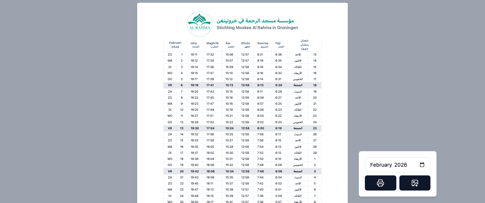

# Groningen Prayer Time

> [!WARNING]
> This project is archived and no longer supported. The prayer times are based on a [PDF booklet](assets/Groningen%20Prayer%20Times.pdf) from 1964, originally made for Den Haag, not Groningen, and are therefore inaccurate. The brothers have been informed, but the masjid continues to use these timetables. This project was made for the sake of Allah, but is kept public archive only as a reference.

Monthly prayer timetable for Groningen, Netherlands.

## Prayer timetable verification

For a short, technical explanation of how the stored JSON timetable was compared against 1960s Den Haag prayer times (using a grid search over cities, methods, and years), see the [prayer times verification report](report/README.md).

## Description

A web app that displays Islamic prayer times (Fajr, Sunrise, Dhuhr, Asr, Maghrib, Isha) for Groningen. Supports Hijri calendar dates, month/year navigation, and exporting the timetable as a printable A4 page or PNG image.

## Setup

```bash
npm install
npm run dev
```

Open [http://localhost:3000](http://localhost:3000) in your browser.

## Data

Prayer times are stored in [`assets/times.json`](assets/times.json) and as per-month CSV files in [`assets/times/`](assets/times/) (`01.csv`, `02.csv`, etc.). The original reference PDF is in [`assets/`](assets/Groningen%20Prayer%20Times.pdf).


