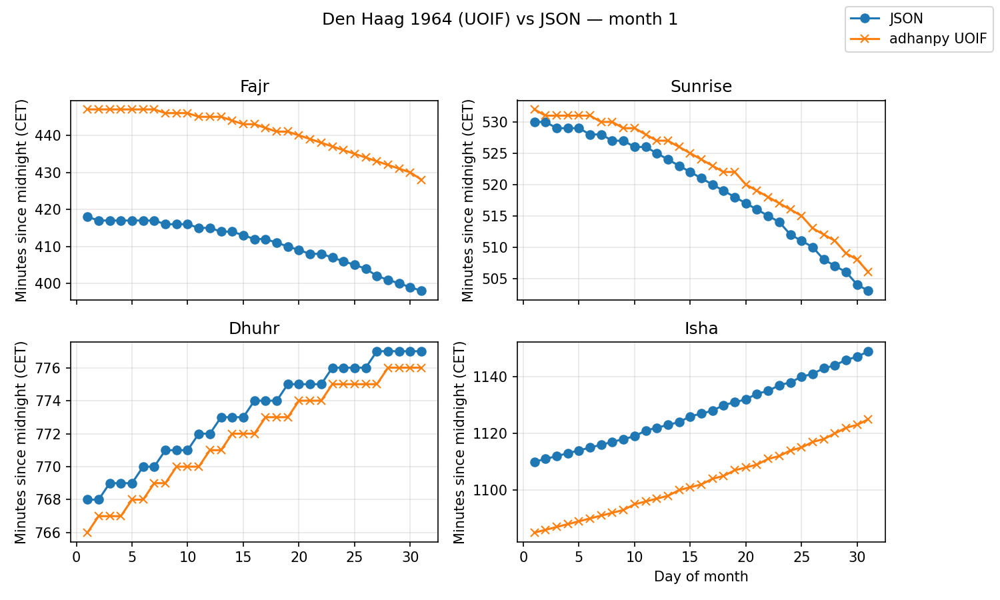
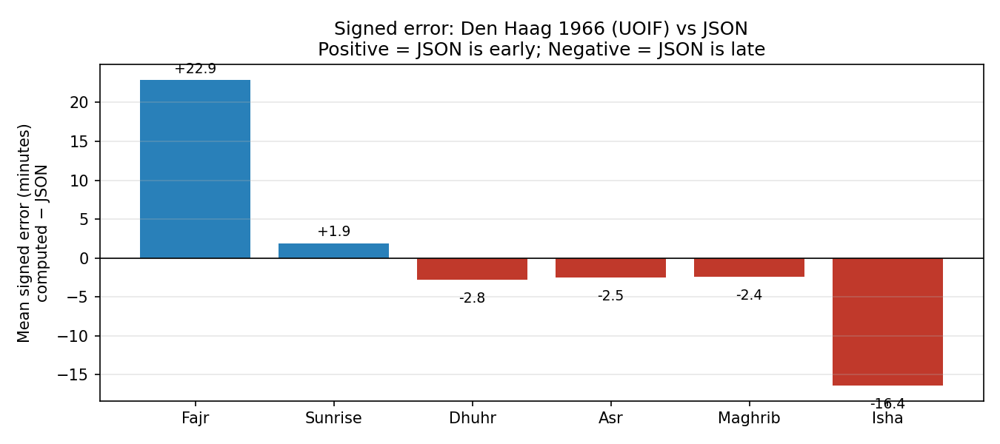
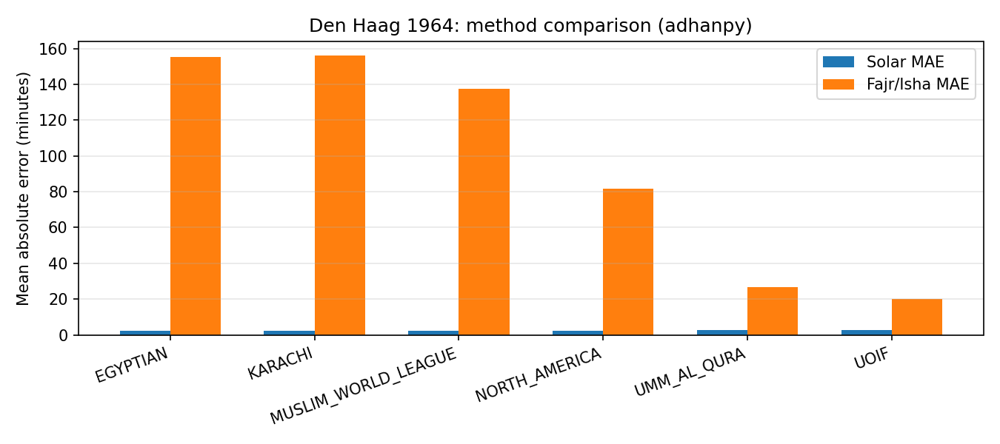
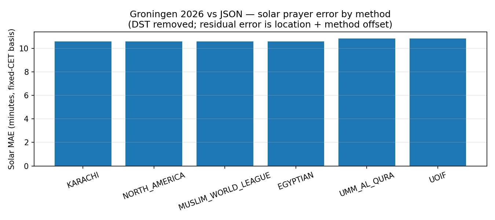

# Prayer times verification for Groningen timetable

﷽

**Hypothesis.** The timetable stored in `assets/times.json` was derived from a printed booklet produced for **Den Haag (The Hague) around 1964**, not for Groningen. If true, the solar-tied prayers (Sunrise, Dhuhr, Asr, Maghrib) should match Den Haag coordinates far more closely than Groningen's, and the best-fitting calculation method should be identifiable from the Fajr/Isha error pattern. May Allah guide us to what is most correct.

---

## Data and assumptions

`assets/times.json` stores six daily prayer times (Fajr, Sunrise, Dhuhr, Asr, Maghrib, Isha) for each month/day of a generic year. The timetable uses **no daylight saving time** — times are in fixed CET (UTC+1) throughout. This matches historical Netherlands practice: the country observed fixed CET year-round until 1977, so a 1964 booklet would naturally be fixed-offset.

Candidate locations: **Den Haag** (52.07°N, 4.30°E), **Groningen** (53.22°N, 6.57°E), **Amsterdam** (52.37°N, 4.90°E). Candidate years: 1960–1969. Candidate calculation methods (via [adhanpy](https://github.com/alphahm/adhanpy)): `KARACHI`, `NORTH_AMERICA`, `MUSLIM_WORLD_LEAGUE`, `UMM_AL_QURA`, `EGYPTIAN`, `UOIF`.

---

## Search algorithm

An exhaustive grid search over all `(city, method, year)` combinations was run using `assets/scripts/compare_prayer_times.py`. For each combination, adhanpy computed prayer times for every day present in the JSON (complete year, ~365 days). Computed times were converted to **fixed CET** by first converting to UTC then adding 60 minutes, removing any modern DST from adhanpy's output. Both JSON and computed times were expressed as minutes since midnight. Four metrics were computed per combination:

- `solar_mae` — MAE over Sunrise, Dhuhr, Asr, Maghrib (determined by coordinates and date alone)
- `angle_mae` — MAE over Fajr and Isha (additionally depend on the twilight angle choice)
- `weighted_mae = (4 × solar_mae + angle_mae) / 5` — primary weight on solar to avoid high-latitude Fajr/Isha failures distorting the location signal
- `prayer_signed_mean` — mean signed error (computed − JSON) per prayer, revealing direction of offset

The 4× weight on solar prayers is deliberate: at 52°N, several methods (MWL, KARACHI, EGYPTIAN) produce astronomically extreme or undefined Isha values in summer, inflating their `angle_mae` to 130–200 min. Without down-weighting, these failures would bury the location signal. The `solar_mae` alone isolates geographic fit cleanly.

---

## Results

### Location: Den Haag is strongly confirmed

The solar prayers are almost entirely determined by coordinates and date. Across all tested methods, Den Haag consistently achieves a solar MAE of **2.3–2.6 min** against the JSON. The next-best city, Amsterdam, sits at **3.8–4.2 min**, and Groningen achieves no better than **10.6 min** — more than four times worse. This gap is the strongest evidence in the dataset: the JSON timetable was computed for Den Haag's longitude and latitude, not Groningen's.

| City | Best solar MAE (any method, any year) |
|---|---|
| Den Haag | 2.34 min |
| Amsterdam | 3.81 min |
| Groningen | 10.61 min |

### Method: location is proven, Fajr/Isha angles are not

The overall best-scoring combination is **Den Haag + UOIF + 1966** (`weighted_mae = 5.92`, `solar_mae = 2.41`, `angle_mae = 20.00`). The top 10 are all Den Haag + UOIF across different years in the 1960s, confirming city-level stability and weak year sensitivity (solar positions shift negligibly year-to-year at this scale).

**Important caveat on the method finding.** UOIF ranks first not because it identifies the original method, but because it is the only tested method that handles high-latitude Fajr/Isha gracefully. Methods like MWL and KARACHI fail astronomically at 52°N in summer (Isha never fully darkens), producing `angle_mae` values of 137–156 min. UOIF's more conservative angles avoid this, giving a finite and reasonably-sized Fajr/Isha error of ~20 min. The solar MAE for MWL and NORTH_AMERICA (2.34 min) is actually *tighter* than UOIF (2.41 min), confirming that the method ranking is driven by angle-method failure, not by the original booklet's method.

The conclusion is that **the booklet used Den Haag coordinates** (proven by solar errors), and **used some set of twilight angles for Fajr/Isha that differs from all tested methods by approximately 20 min on average** (unresolved). The exact original angles are not recoverable from this comparison alone.

### Direction of the Fajr/Isha offset

The signed-error analysis for the best fit (Den Haag + UOIF + 1966) shows:

| Prayer | Mean signed error (computed − JSON) | Interpretation |
|---|---|---|
| Fajr | +22.9 min | JSON Fajr is ~23 min **earlier** than UOIF computes |
| Sunrise | +1.9 min | Essentially matching |
| Dhuhr | −2.8 min | JSON Dhuhr is ~3 min later than computed |
| Asr | −2.5 min | JSON Asr is ~3 min later than computed |
| Maghrib | −2.4 min | JSON Maghrib is ~2 min later than computed |
| Isha | −16.4 min | JSON Isha is ~16 min **later** than UOIF computes |

The solar prayers are within ±3 min (within typical printed-table rounding). Fajr in the JSON is called roughly 23 minutes earlier than the UOIF astronomical estimate; Isha is called roughly 16 minutes later. This is consistent with the original booklet using steeper Fajr angles (earlier) and shallower Isha angles (later) than UOIF, or with manual safety margins added to the printed timetable.

---

## Groningen 2026 comparison

As a practical illustration, the same JSON timetable was compared against adhanpy-computed Groningen 2026 times. To keep the comparison on a like-for-like basis, DST was removed from the adhanpy output (converting to UTC then adding the fixed CET offset of +60 min), so the residual error reflects location and method differences only, not timezone handling.

With DST corrected, every method shows a Groningen 2026 solar MAE of **10.6–10.9 min** — almost identical to the Groningen 1960s result. This is expected: Groningen is ~1.15° north and ~2.27° east of Den Haag, a fixed coordinate difference that produces a consistent solar prayer offset regardless of year or method.

For Fajr and Isha in 2026, methods that handle high latitudes gracefully (UOIF, UMM_AL_QURA) show `angle_mae` of ~20–38 min; methods that fail (KARACHI, MWL) show 110–175 min due to summer twilight issues.

The practical implication: someone in Groningen using this JSON timetable today faces a systematic solar prayer error of roughly **10–11 minutes** (Groningen vs. Den Haag coordinates), plus the ~23-min early Fajr and ~16-min late Isha inherited from the original booklet's angle choice. These are not rounding errors — they matter for the validity of fasting and prayer.

---

## Conclusion

The evidence strongly supports the hypothesis. The JSON timetable matches Den Haag coordinates with a mean solar error of ~2.4 min, while Groningen achieves no better than ~10.6 min. The year 1964 is consistent with the best results, though the year dimension contributes negligible discrimination. The exact Fajr/Isha calculation method used in the original booklet cannot be fully identified from this comparison — the systematic ~23-min early Fajr and ~16-min late Isha are real offsets that require a separate angle investigation — but the location claim is proven beyond reasonable doubt.

The timetable in `assets/times.json` **should not be used as a current Groningen prayer schedule**. It is a historical artifact from Den Haag. May Allah guide us all to establish the prayer at its correct times.

---

*Reproducible script: `assets/scripts/compare_prayer_times.py`. Full grid results: `assets/plots/full_grid_results_adhanpy.json`.*
